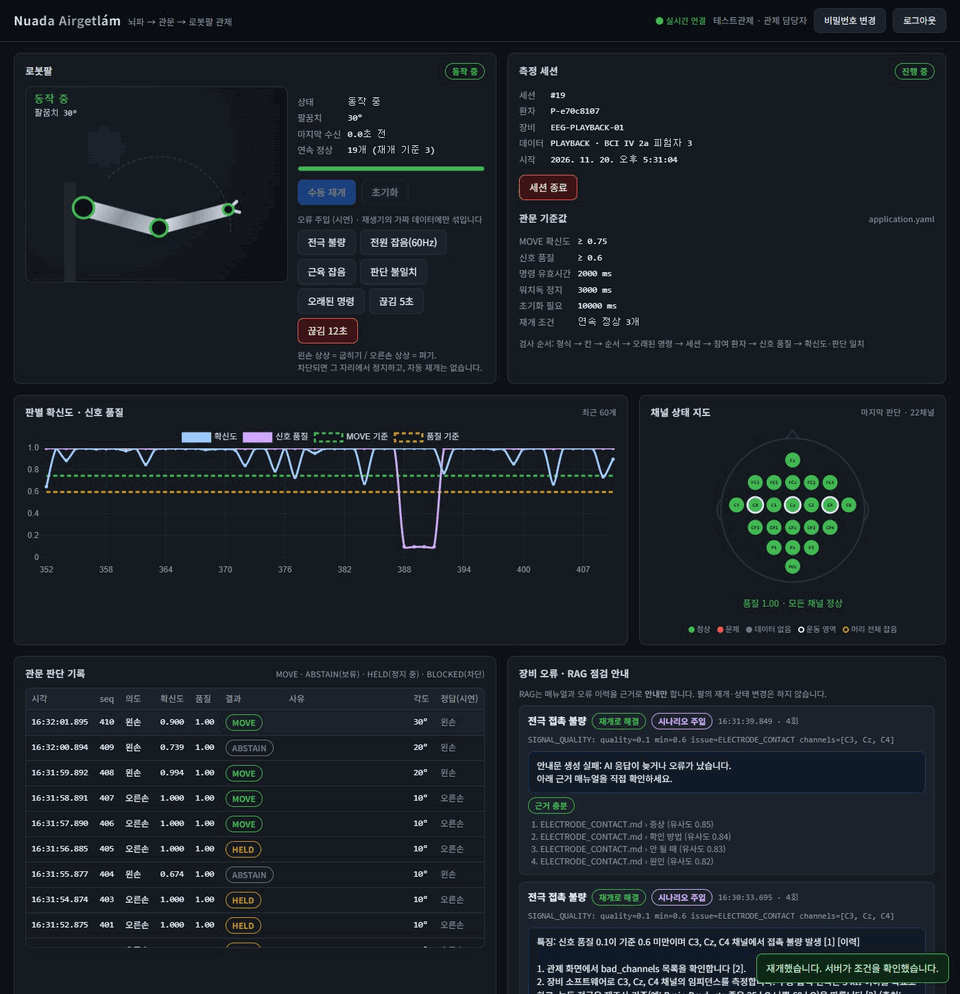
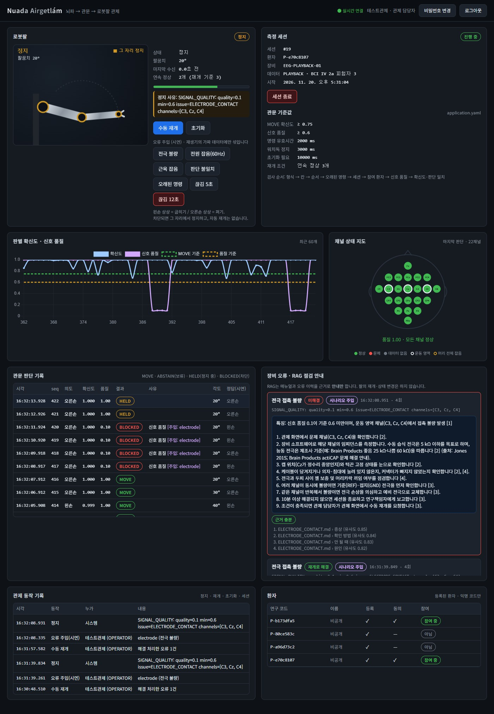
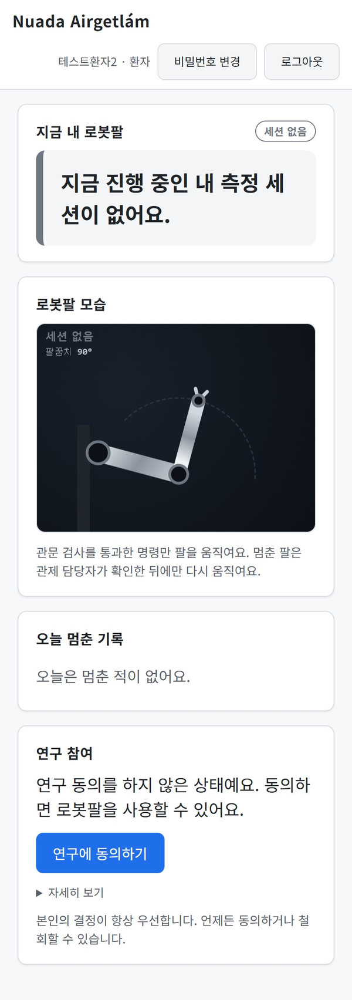
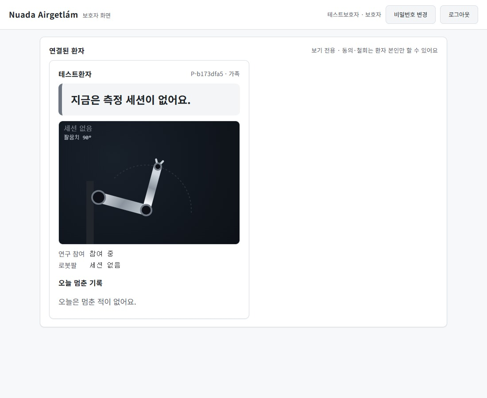

# Nuada Airgetlám

> 뇌파 판별 결과를 **안전 관문**이 다시 검사해 가상 로봇팔을 움직이고, 장비 오류가 나면 그 자리에서 정지·기록하고
> **RAG가 매뉴얼 근거로 점검 방법을 안내**하는 관제 시스템



> 관제 화면 데모 (약 16초): 정상 동작 → 시연용 **전극 불량** 주입 → 관문이 차단해 팔이 그 자리에 정지,
> 채널 지도에 문제 채널(C3·Cz·C4) 표시 → RAG가 매뉴얼 근거로 점검 안내 → 연속 정상 데이터가 쌓인 뒤 **사람이 수동 재개**

> **이 저장소는 AI 코딩 에이전트(Claude Code) 활용 실험이며, 2026-11-26 마무리했습니다.**
> 1. **1차 실험 (11/20) — 맡기기:** 구현의 대부분을 Claude Code가 맡았고, 저는 설계를 결정하고 모든 단계를 직접 실행해 확인했습니다.
> 2. **2차 실험 (11/21~11/26) — 직접 하기:** 1차 회고의 "AI가 만든 코드가 블랙박스가 된다"는 문제를 줄이려고,
>    협업 기반(이슈·템플릿·CI·브랜치 보호)은 **제가 직접** 하고 Claude Code는 안내·설명·리뷰만 했습니다 (가이드 모드).
> 3. **마무리 (11/26) — 다시 맡기기:** 남은 일(환자·보호자 화면 개선, LangChain RAG 비교, 이 README의 데모)은 Claude Code에게 위임했습니다.
>    배포·PWA·모바일 앱은 이 프로젝트에서 하지 않기로 했습니다 ([`docs/roadmap.md`](docs/roadmap.md) 11/26 결정).
>
> 무엇을 AI가 했고, 무엇을 제가 결정했고, AI가 틀린 것을 어떻게 잡았는지는 아래 문서에 그대로 남겼습니다.
> - [`docs/retrospective.md`](docs/retrospective.md) — 1차·2차 실험 회고 (결과·소감·블랙박스 문제·두 방식 비교)
> - [`docs/portfolio-log.md`](docs/portfolio-log.md) — 작업마다 문제 / AI 도움 / 내 판단 / 검증 / 실험 노트
> - [`CLAUDE.md`](CLAUDE.md) — AI에게 준 진행 규칙(2-1장 가이드 모드 포함)과 내 설계 결정
>
> 의료기기가 아닌 학습용 프로토타입이며, 실제 환자 데이터 대신 공개 뇌파 데이터(BCI Competition IV 2a)를 재생합니다.

## 프로젝트 이름의 의미

아일랜드 신화의 왕 **누아다(Nuada)**는 전투에서 팔을 잃고 왕위에서 물러나야 했습니다.
그러나 은으로 만든 팔, **아르게틀람(Airgetlám, "은의 팔")**을 얻어 다시 왕좌로 돌아옵니다.
몸을 움직일 수 없는 사람이 **생각만으로 팔을 되찾는 것**을 안전하게 지켜보는 관제층을 만드는 것이 이 프로젝트의 목표입니다.

## 흐름

```
[재생기: 공개 뇌파 재생 → 판별(CSP+LDA) → 신호 품질] ──WebSocket──▶ [Spring 안전 관문]
        ▲ 오류 주입 명령(시연)                                       │ 형식·순서·신선도·신호 품질·확신도 재검사
        └──────────────── 관제 화면 버튼 ◀──────────────────────────┤
                                                                     ├─ 통과 → 가상 로봇팔 동작
                                                                     └─ 차단 → 그 자리 정지 + 기록 + RAG 점검 안내
                                                                              (자동 재개 없음, 조건 확인 후 사람이 수동 재개)
```

## 주요 기능

| 영역 | 기능 |
|---|---|
| 안전 관문 | 판별기를 믿지 않고 다시 검사, 이상한 입력도 반드시 기록, 워치독(3초 정지·10초 초기화 필요) |
| 관제 화면 | 로봇팔·확신도/신호 품질 그래프, **22채널 상태 지도**, 판단·오류·관제 동작 기록, 수동 재개·초기화, **오류 주입 버튼(시연 모드)** |
| RAG 안내 | 점검 매뉴얼 8개(출처 포함) 검색 → Gemini 안내문, 생성 실패해도 근거는 표시. **안내만** 하고 팔은 제어하지 않음 |
| 역할별 화면 | 관제 담당자·연구책임자·연구자 / 환자(쉬운 말 상태·오늘 기록·연구 동의) / 보호자 / 관리자 |
| 계정·보안 | 관리자 발급 + 임시 비밀번호(첫 로그인 변경 강제), 환자·보호자 초대 링크, 5회 실패 잠금, 로그인 기록, 30분 자동 로그아웃 |
| 개인정보 | 동의하지 않은 환자 데이터는 연구에 쓰지 않음, 철회 시 연구 데이터 삭제, 관제 담당자는 익명 코드만 |

## 화면

| 관제 화면 (관제 담당자·연구책임자) | 환자 화면 (휴대폰) | 보호자 화면 |
|---|---|---|
|  |  |  |
| 어두운 관제실 테마. 그래프로 "언제", 채널 지도로 "어디가" 나빠졌는지 | 밝은 배경·큰 글씨, 정지 사유는 서버가 **쉬운 말**로 바꿔 보냄 | 보기 전용. 동의·철회는 환자 본인만 |

사진과 GIF는 [`scripts/capture_demo.py`](scripts/capture_demo.py)가 Docker 시연 환경에서 자동으로 찍습니다.

## RAG: 직접 구현 vs LangChain

점검 안내 RAG는 LangChain 없이 직접 구현했고(`ai-server-python/rag/`), 마무리 단계에서 같은 기능을 LangChain으로 다시 만들어 비교했습니다
([`ai-server-python/rag_langchain/`](ai-server-python/rag_langchain/README.md)).

| 항목 | 결과 |
|---|---|
| 자르기·검색 | 조각 40개 완전히 같음, 오류 8종 검색 결과 8/8 일치 |
| 미니 평가 10문항 (증상만 보고 질문) | 두 구현 모두 정답 매뉴얼 1등 9/10, 3등 안 10/10 |
| 코드 줄 수 (핵심) | 101줄 vs 99줄 |
| 배운 것 | 품질은 프레임워크가 아니라 자르기·임베딩·검색 규칙이 정한다. LangChain에는 "재시도 6번" 같은 숨은 기본값이 있어 직접 구현의 25초 제한 결정과 맞추려면 소스를 읽어야 했다 |

## 기술 스택

- **Backend:** Java 21, Spring Boot 4, Spring Data JPA, Spring Security(JWT, HttpOnly 쿠키), WebSocket, MySQL 8
- **AI / BCI:** Python 3.11, MNE, MOABB, scikit-learn(CSP+LDA), FastAPI, Chroma, Gemini API (RAG는 직접 구현 + 비교용 LangChain 구현)
- **Frontend:** HTML, CSS, JavaScript (Canvas, SVG, Chart.js)
- **Infra·협업:** Docker Compose, GitHub Actions CI(Spring 테스트·Python 문법 검사), main 브랜치 보호(PR + 필수 검사), Issues·Projects

## 폴더 구조

```
nuada-airgetlam/
├── backend-spring/     # Spring: 관문, 로봇팔, 기록, 관제 화면, 인증, 환자·계정
├── ai-server-python/   # 판별기 학습, 재생기(realtime/), RAG 서버(rag/), LangChain 비교 구현(rag_langchain/)
├── scripts/            # 로컬 실행 스크립트, README 데모 촬영(capture_demo.py)
├── docs/               # 회고, 작업 기록, 로드맵, 메시지 규격, ERD, 실행 문서, 화면 사진(images/)
└── docker-compose.yml
```

## 실행하기

| 방법 | 문서 | 한 줄 요약 |
|---|---|---|
| 로컬 (Docker 없이) | [docs/local-run.md](docs/local-run.md) | JDK 21 + MySQL 8 + Python, `scripts\run-*.ps1` 세 개 |
| Docker Compose | [docs/deploy.md](docs/deploy.md) | `docker compose up -d --build` → http://localhost:8081, 오류 주입은 관제 화면 버튼 |
| 다른 컴퓨터에서 시연 | [docs/demo-guide.md](docs/demo-guide.md) | `git clone` → `.env` 준비 → Docker 실행, 시연 순서·주의점·체크리스트 |

두 방법 모두 저장소 최상위 `.env`(견본: `.env.example`) 하나를 읽습니다.
REST API 29개·WebSocket·RAG API는 [docs/api-spec.md](docs/api-spec.md), 관문 메시지 규격과 검사 순서는 [docs/message-spec.md](docs/message-spec.md), DB 테이블 10개와 설계 이유는 [docs/ERD.md](docs/ERD.md).
