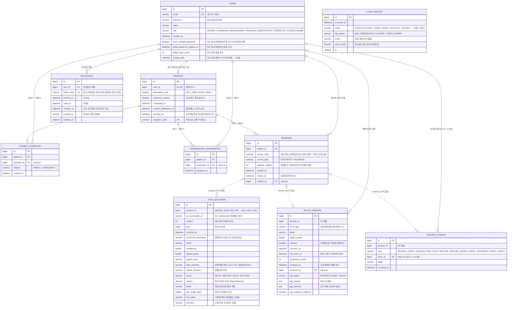

# Nuada Airgetlám — ERD (v2)

> 갱신: 2026-11-21 — 실제 엔티티 10개(`backend-spring/src/main/java/.../@Entity`) 기준으로 다시 씀.
> v1(2026-10-28)은 구현 전 설계였고, 그 뒤 관문·기록·계정 보안이 들어오면서 테이블이 바뀌었다 (맨 아래 "v1 → v2" 참고).
> 테이블은 JPA가 서버 시작 때 만든다 (`ddl-auto: update`). 칸 이름은 Java의 `camelCase`가 DB에서 `snake_case`로 바뀐다.

## 1. 한눈에 보기

| 묶음 | 테이블 | 하는 일 |
|---|---|---|
| 사람 | `users`, `patients`, `patient_guardians`, `researcher_assignments` | 계정, 환자 정보(동의·익명 코드), 환자–보호자 연결, 연구자 배정 |
| 측정 | `sessions` | 한 번의 측정 단위. 관문은 열린 세션이 있어야 팔을 움직인다 |
| 기록 | `gate_decisions`, `device_errors`, `control_events` | 관문 판단 하나하나, 장비 오류 + RAG 안내, 정지·재개 같은 관제 동작 |
| 계정 보안 | `login_history`, `invitations` | 로그인 성공·실패와 계정 변경 기록, 환자·보호자 초대 링크 |

## 2. 전체 관계도

실선(`--`)은 실제 외래 키(FK), 점선(`..`)은 **FK 없이 id 숫자만 저장**하는 관계다.

## 3. 설계 결정 기록

### 사람·측정 (v1부터 유지)
| 결정 | 이유 |
|---|---|
| 환자–보호자를 연결 테이블로 분리 (N:M) | 환자 한 명에 보호자 여러 명, 보호자 한 명이 환자 여러 명을 돌볼 수 있음. 관계 종류도 저장. 같은 조합은 한 번만(unique) |
| 연구자 배정 테이블 분리 (N:M) | 연구자가 배정받은 환자만 실명으로 봄. 같은 조합은 한 번만(unique) |
| 환자에 익명 코드(`research_code`) | 관제 담당자·미배정 연구자는 이름 대신 익명 코드만 봄 |
| 연구 데이터는 **동의한 환자만** | 관문 규칙 ①: 등록 + 동의 중이 아니면 `NOT_PARTICIPATING`으로 차단 |
| 동의 철회 시 철회 시각과 계정은 유지 | 연구 데이터는 지우되 "언제 철회했는지"는 남겨야 함 (CLAUDE.md 6장) |
| 테이블 이름 `users` (복수형) | `user`는 일부 DB에서 예약어 |

### 기록 (관문 도입 후)
| 결정 | 이유 |
|---|---|
| 기록 테이블의 `session_id`는 **FK 없이 숫자만** | 관문은 세션이 없거나 이상한 입력에도 **기록은 반드시 남긴다**. FK가 있으면 없는 세션 번호에서 저장이 실패할 수 있음 |
| 긴 값은 잘라서 저장 (`detail` 300자, `bad_channels` 200자) | 같은 원칙: 이상한 입력 때문에 저장이 실패하지 않게 |
| `bad_channels`는 표가 아니라 `"C3,Cz,C4"` 글자 | 화면에 마지막 판단만 보여 주면 되고, 채널별로 검색할 일이 없음 (B1 결정) |
| 같은 오류는 행 하나로 묶음 (`occurrence_count`, `last_seen_at`) | 잡음이 이어지면 매 메시지마다 오류 카드가 쌓이고 RAG가 반복 호출됨 |
| RAG 결과를 `device_errors`에 함께 저장 | 오류 1건 = 안내 1건. 생성이 실패해도(`FAILED`) 근거(`rag_sources`)는 남김 (A2) |
| `control_events.actor_id`가 NULL이면 시스템 | 정지는 시스템이, 재개는 사람이 한다는 구분이 기록에 보이게 (자동 재개 없음) |

### 계정 보안 (R2~R4)
| 결정 | 이유 |
|---|---|
| `login_history`에 계정 발급·변경·잠금 해제·초대도 함께 | 로그인 관련 감사 기록을 한 곳에서 봄. 보관 방침 1년 |
| `login_history.email`은 FK 없는 글자 | 없는 이메일로 로그인 실패한 것도 기록해야 함 |
| 초대 토큰은 SHA-256 해시만 저장 | DB가 새어도 링크를 다시 만들 수 없게 (비밀번호를 해시로 저장하는 것과 같은 이유) |
| 종류 칸(enum)은 varchar로 저장 (`@JdbcTypeCode(SqlTypes.VARCHAR)`) | Hibernate가 MySQL에 `enum('A','B')` 칸을 만들면 새 값을 추가할 때 저장이 실패함 (R4에서 발견, `login_history`·`control_events`에 적용) |

## 4. v1 → v2에서 바뀐 것

| v1 (10/28) | v2 (지금) | 이유 |
|---|---|---|
| `arm_movements` (관절 5개 각도, 버튼/뇌파 모드) | 없음 → `gate_decisions.arm_angle_after` | 버튼 모드를 빼고, 팔 움직임은 관문 판단 기록에 붙임. 가상 팔은 팔꿈치 1축 |
| `eeg_records` (뇌파 파일 메타데이터) | 없음 | 공개 데이터(BCI IV 2a)를 재생하므로 파일을 저장하지 않음. `sessions.dataset_subject`로 피험자만 기록 |
| `sessions.mode` (BUTTON / EEG) | `source_type`, `device_code`, `dataset_subject`, `started_by` | 측정 장비와 데이터 출처, 누가 시작했는지가 관제에 필요 |
| 역할 3개 | 역할 6개 | 연구책임자·관제 담당자·시스템 관리자 추가 |
| — | `gate_decisions`, `device_errors`, `control_events`, `login_history`, `invitations` | 관문·RAG·계정 보안 기능으로 추가 |
